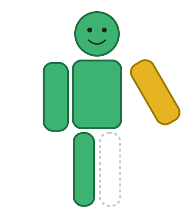

*Taller 3 para analistas estadísticos*

**APIs con FastAPI y trabajo colaborativo en GitHub**

Un proceso estadístico en seis etapas, un servicio por persona y un muñeco que solo queda completo cuando todo cumple el contrato.

  

Guía completa para trabajar en casa, módulos 0 a 4 y apéndices.
