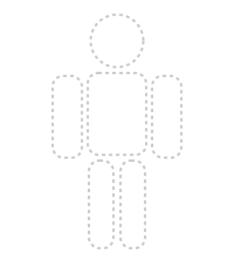
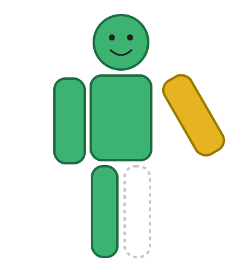
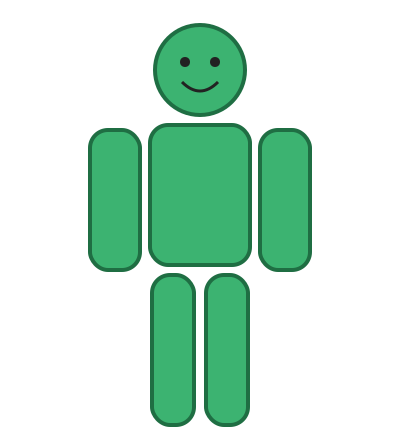

# Introducción

### ¿A quién va dirigido este taller?

A quienes completaron el Taller 1 (Python, entornos virtuales, Git básico) y el taller de Kedro. Ya sabes escribir un script con funciones, crear un entorno virtual, instalar paquetes y subir tu propio repositorio a GitHub. Lo que todavía no has hecho es trabajar con cinco personas **en el mismo repositorio**, ni exponer tu código para que otro programa lo use sin importar tu archivo.

Esas dos cosas son exactamente lo que este taller enseña. No son temas de "desarrollador": son las habilidades que separan un análisis que vive en el computador de una persona de un proceso que la entidad puede ejecutar, revisar y mantener.

### ¿Qué vas a aprender?

| Módulo | Tema | Resultado al finalizar |
|----|----|----|
| 0 | Preparar el terreno | El repositorio compartido clonado en tu PC personal, corriendo y con el muñeco vacío en pantalla |
| 1 | Qué es una API (FastAPI) | Tu primer servicio HTTP corriendo, con documentación automática y validación de tipos |
| 2 | Tu etapa del proceso | La etapa que te corresponde implementada y aprobada por el contrato en tu máquina |
| 3 | Git colaborativo | Tu rama subida, con Pull Request revisado, rebase sobre main y la integración continua en verde |
| 4 | Ensamble final | El muñeco completo con las seis etapas y el proceso corriendo de punta a punta |

Hay además dos apéndices: una referencia rápida de comandos Git y un ejemplo de cómo se implementa una etapa en R con `plumber`, para quienes quieran seguir en R.

### La idea del taller: un proceso estadístico dividido en seis

Vamos a procesar una **encuesta de hogares ficticia** (1.215 registros generados con semilla, así que son los mismos para todos). El proceso tiene seis etapas, del tipo que hace un equipo de estadística oficial: validar, limpiar, calibrar factores de expansión, estimar indicadores, calcular precisión y publicar. Cada participante es responsable de **una** etapa.

Cada etapa se implementa como un **servicio**: un pequeño programa que escucha en un puerto de tu computador, recibe datos en formato JSON, hace su parte del trabajo y devuelve el resultado también en JSON. Un séptimo programa, el **ensamblador**, llama a las seis etapas y verifica que cada una cumpla lo pactado.

| # | Etapa | Qué hace | Parte del muñeco | Puerto |
|----|----|----|----|----|
| 1 | validar | Carga el CSV, verifica columnas y tipos, cuenta nulos | Cabeza | 8001 |
| 2 | limpiar | Elimina duplicados, trata atípicos, imputa ingresos faltantes | Torso | 8002 |
| 3 | calibrar | Ajusta los factores de expansión a totales poblacionales conocidos | Brazo izquierdo | 8003 |
| 4 | indicadores | Estima tasa de ocupación e ingreso promedio, ponderados | Brazo derecho | 8004 |
| 5 | precision | Error estándar, coeficiente de variación e intervalos de confianza | Pierna izquierda | 8005 |
| 6 | publicar | Clasifica la calidad de cada estimación, agrega metadatos y exporta a Excel | Pierna derecha | 8006 |

### El muñeco: una prueba de integración que se ve

El ensamblador dibuja un muñeco con seis partes. Cada parte refleja el estado de una etapa:

- **Punteada (ausente):** el servicio no responde o todavía no está implementado. Esa persona no ha hecho su parte.
- **Amarilla y torcida (chueca):** el servicio responde, pero lo que devuelve no cumple el contrato: falta un campo, una tasa es mayor que 1, los factores no suman la población. Esa persona hizo algo, pero mal.
- **Verde y derecha (ok):** la etapa cumple el contrato.

  

*Izquierda: nadie ha empezado. Centro: la etapa 4 devuelve tasas en porcentaje en vez de proporción (chueca) y la 6 no está implementada (ausente). Derecha: las seis etapas cumplen el contrato.*

Esto no es un adorno. En ingeniería de software se llama **prueba de contrato**: un acuerdo explícito sobre qué entra y qué sale de cada componente, verificado automáticamente. El muñeco es solo una forma amable de mostrar el resultado de esa verificación. Lo importante es que aprendas a leer por qué una parte sale chueca y a corregirla.

### Las reglas del juego

1. Cada persona trabaja **solo** en la carpeta de su etapa (`etapas/etapa_N_.../`).
1. Nadie trabaja directo en la rama `main`. Cada quien tiene su rama y entrega mediante Pull Request.
1. Un Pull Request se mezcla únicamente cuando un compañero lo revisó **y** las pruebas automáticas están en verde.
1. El contrato (carpeta `contrato/`) es de todos. Cambiarlo requiere un Pull Request aparte que revisa el equipo completo.
1. Antes de pedir revisión, cada quien trae los últimos cambios de `main` a su rama con `rebase`. Habrá al menos un cambio de contrato durante el taller, a propósito, para que practiquen.

### Convenciones tipográficas

| Elemento | Significado |
|----|----|
| `código en línea` | Nombres de archivos, comandos, rutas, variables o funciones |
| Bloque gris monospace | Comando para ejecutar en terminal, o código para escribir en un archivo |
| 📘 Concepto morado | Explicación de fondo: qué es y por qué existe |
| 💡 Tip azul | Atajo, recomendación o paralelo con lo que ya conoces |
| ⚠️ Atención amarillo | Error común o algo que debes leer con cuidado |
| ✅ Checkpoint verde | Estado esperado: si lo ves, vas bien |

### Cómo trabajar con la guía

El taller está diseñado para hacerse **en casa, en tu computador personal** y a tu ritmo. Los módulos 0 y 1 son individuales. El módulo 2 también, pero depende de la etapa que te asignaron. El módulo 3 es donde el trabajo se vuelve colectivo: vas a necesitar que otro compañero revise tu código y tú vas a revisar el de alguien más. El módulo 4 cierra cuando las seis etapas estén mezcladas en `main`.

Sigue los pasos en orden y detente en cada checkpoint. Cuando algo falle, revisa primero la tabla de troubleshooting del módulo. Y cuando uses un asistente de IA, aplica lo del Taller 1: primero entiende, después aceptas.

> [!WARNING]
> **⚠️ Atención**
>
> Trabaja en tu **PC personal**, no en el equipo institucional. Vas a instalar paquetes, abrir puertos locales (8000 a 8006) y ejecutar servicios; en un equipo corporativo eso suele estar restringido por políticas de seguridad y te vas a frustrar por razones que no tienen que ver con el taller. Nada de lo que hacemos aquí toca datos reales: la encuesta es sintética.
